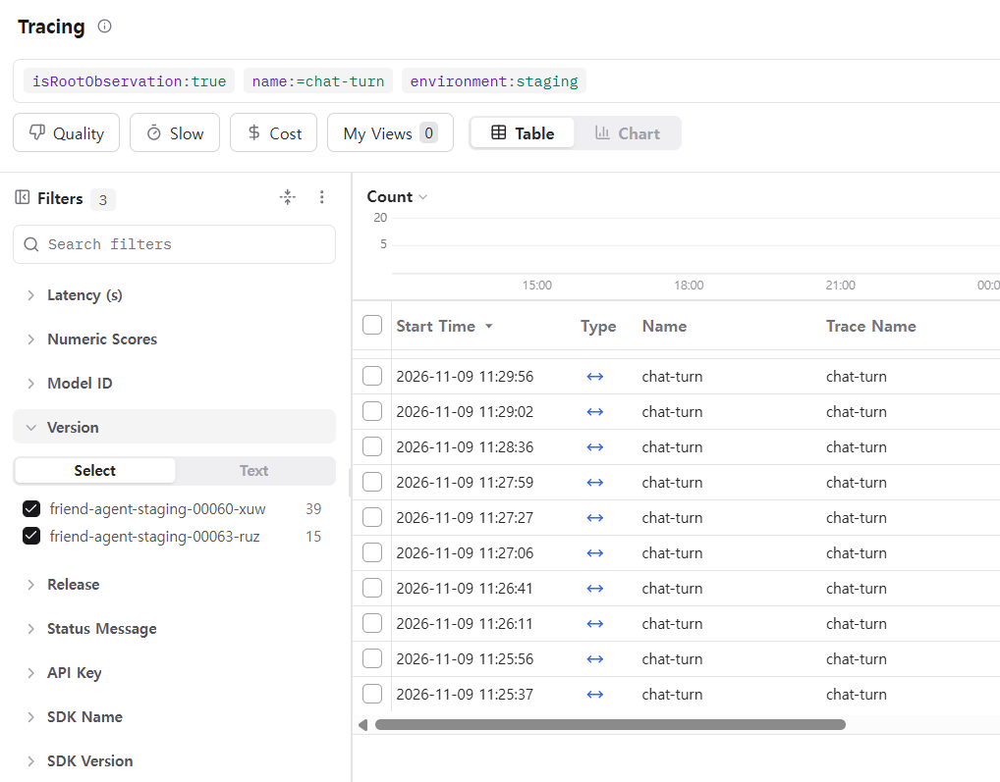
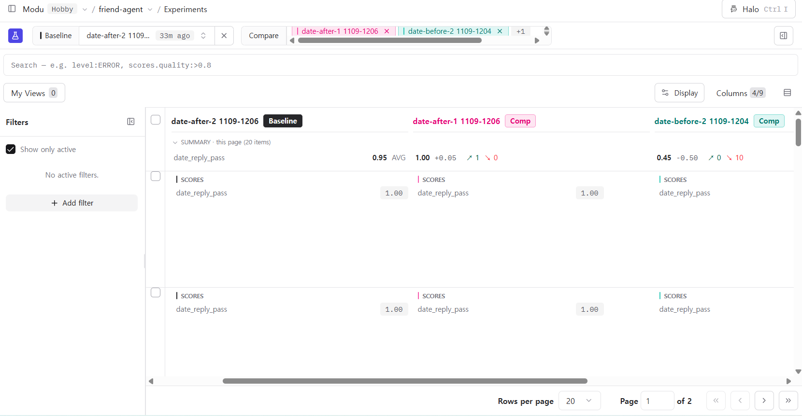

# 로그와 피드백으로 에이전트 개선하기

AI 친구 에이전트의 Langfuse 트레이스와 사용자 피드백에서 문제를 찾았다. 그중 하나를 골라 고치고, 고친 뒤 나아졌는지 확인했다.

트레이스 링크는 Langfuse 프로젝트 안에서만 열린다.
형식은 `https://us.cloud.langfuse.com/project/cmvyofbq3035aad0g2zs4vu8d/traces/<id>` 이고, 아래에서는 앞 8자리만 적는다.

## 1. 로그

| 항목 | 수 |
| --- | --- |
| Langfuse 트레이스 전체 | 1,372 (11/2~11/9) |
| 그중 실제 대화 턴(`chat-turn`) | 267 |
| 그중 staging 배포 대화 | 63 (리비전 00030~00063) |
| 명시적 피드백 👎 / 👍 | 13 / 2 |
| 신고 | 4 |

- 도구 선택 실험 트레이스(`experiment-item-run`) 1,112개는 사용 기록이 아니어서 분석에서 뺐다.
- 대화 원문은 내려받아 로컬에서만 읽었고, 저장소에는 올리지 않았다.

**직접 만든 대화.** 분석을 시작할 때 피드백은 3개뿐이었다. 그래서 대화를 두 가지 방법으로 더 만들었다.

1. **스크립트.** `scripts/simulate_users.py` 로 사용자 유형 8종의 대화를 6턴씩, 모두 48턴 보냈다.
   - 서버: 로컬, Langfuse 환경 이름 `sim`.
   - 유형: 바쁜 직장인, 짧게 말하는 사람, 고민 상담, 기억 확인, 일정 확인, 주제 전환, 되묻기, 말투 민감.
   - 대화마다 "아니 3시 말고 4시로", "또 길다" 같은 정정 턴을 섞었다.
   - 실제 개인정보는 쓰지 않았다.
2. **직접 대화.** staging 화면에서 직접 39턴 대화하고, 별로인 답에 👎를 눌렀다.

## 2. 문제 후보

👎·신고가 붙은 턴과 정정 턴("아니", "또", "거짓말")을 먼저 읽었다. 그다음 같은 현상이 몇 번 나오는지 실제 대화 턴 267개 전체에서 셌다. 셀 때 쓴 규칙은 아래와 같다.

| 후보 | 세는 규칙 |
| --- | --- |
| A | 답에 나온 연도가 대화 시점과 다른 턴. 틀린 연도에 동의한 턴도 넣었다 |
| D | 메시지의 요일과 저장된 날짜의 요일이 다른 턴 |
| C | 부탁하는 말 없이 `create_reminder` 가 실행된 턴 |
| B | 도구는 성공했는데 답이 "할 수 없다"고 한 턴. 지원하지 않는 도시라서 거절한 경우는 정상이므로 뺐다 |

| | 현상 | 근거 트레이스 | 반복 | 처음 어긋난 단계 |
| --- | --- | --- | --- | --- |
| A | 답이 올해 연도를 지어낸다(2020, 2023, 2014). 사용자가 따지면 사과만 반복한다 | `52d438b6` `da6a5fde` `fc8cc728` `36082ea2` `a01cfbaa` | 연도 오답 5회. 따지는 후속 턴 7회. **👎 13개 중 10개** | ④ 답 생성. 지시문 `[지금]`이 `11월 9일(월) 11:35` 처럼 연도 없이 들어간다 |
| D | 요일을 날짜로 잘못 바꾼다. "이번 주 금요일"을 11/11(수)로, "다음 주 토요일"을 11/12(목)로 저장했다 | `232c3c45` `e5376536` `e6fe3347` `3d25a146` `b6d8dcd9` | 5회 | ② 도구 선택. 모델이 계산하고, 코드는 '전날' 표현만 다시 계산한다 |
| C | 부탁하지 않은 약속을 저장한다. "내일이 2014년 7월 21일이지?", "아까 말한 드라마 다시 말해줘" 같은 말에도 저장했다 | `7690a14e` `36082ea2` `01d290fd` | 3회. 애매한 2회는 따로 뺐다 | ② 도구 선택 |
| B | 도구는 성공했는데 답은 "알려줄 수 없어"라고 한다 | `ca252174` `cc473de4` `e4e6cdc9` | 3회. 배포 뒤 `525e1bbc` 에서 1회 더 나왔다 | ④ 답 생성 |
| E | 사실을 지어내고 사용자 말에 모두 동의한다. 풍기 한약재로 '양파'를 들었다. 풍기의 '풍'이 바람이라는 말과 풍년이라는 말에 둘 다 "맞아"라고 했다 | `2d5fa571` `85b70ee2` `1316e324`(신고) | 4회 | ④ 답 생성(모델 지식) |

**지연과 비용은 문제로 보지 않았다.** 턴 지연은 p50 3.9초, p95 9.1초다. 비용은 턴당 $0.0004다.

## 3. 고른 문제와 이유

| | 빈도 | 영향 | 고치는 비용 |
| --- | --- | --- | --- |
| **A 연도** | 중간(5회). 날짜를 물으면 매번 생길 수 있다 | **큼.** 👎가 가장 많이 몰렸다. 한 번 틀리면 "거짓말"이라며 대화 전체의 신뢰가 무너졌다 | **아주 작음.** 원인이 지시문 한 곳이다 |
| D 요일 | 중간(5회) | 큼. 약속이 엉뚱한 날에 울린다 | 중간. 코드 보정 규칙을 넓혀야 한다 |
| C 불필요한 약속 | 낮음(3회) | 중간. 쓰레기 약속이 쌓인다 | 중간. 지시문을 고치고 다시 평가해야 한다 |
| B 성공했는데 못 한다고 함 | 낮음(3~4회) | 중간 | 중간 |
| E 지어내기·동의 | 낮음(4회) | 중간 | 큼. 측정 기준을 만들기도 어렵다 |

**A를 먼저 고친다.**
- 사용자가 실제로 불만을 표시한 반응이 가장 많다.
- 트레이스에서 원인이 한 곳으로 확인됐다. 답 생성 지시문 `[지금]` 에 연도가 없다. 날짜 표와 요일은 있어서 월·일은 맞히고 연도만 지어냈다.
- 한 가지만 바꾸면 되어서, 전후 차이가 그 변경 때문인지 분명히 가릴 수 있다.
- D는 영향이 크지만 고칠 범위가 넓어서 다음 순서로 둔다.

## 4. 데이터셋과 기준 (실험 전에 적음)

- 데이터셋: `data/eval/date_reply.jsonl`, Langfuse 데이터셋 이름 `date-reply`.
- **문제 12개:**
  - 👎 트레이스를 그대로 옮긴 5개. 앞 대화(history)까지 넣었다.
  - 같은 원인을 다른 말로 묻는 7개. "내년은 몇 년이야?", "1990년생 만 나이" 등.
- **정상 12개:** 일상 대화, 날씨·약속 도구 결과 전달, 요일·날짜 계산, 기억. 고친 뒤에도 원래 되던 것이 그대로 되는지 본다.
- **통과 조건** (코드 평가자, `scripts/run_date_experiment.py`):
  - 답에 나온 `NNNN년` 은 2026 이거나 항목에서 허용한 연도여야 한다. 예: D03 "내일이 2014년 7월 21일이지?"는 2014를 허용한다.
  - `must_include` 가 모두 들어 있어야 한다. 예: D08 "내년은 몇 년이야?"에는 `2027`.
  - `must_exclude` 가 없어야 한다. 예: 정상 일상 대화에는 묻지 않은 `2026년` 을 끼워 넣지 않는다. 날씨 결과 전달에는 `수 없` 이 없어야 한다.
- **실행:** 고치기 전과 후를 각각 2회 돌린다. 모델은 gpt-4o-mini, 기준 시각은 2026-11-09 11:00 KST로 고정했다.
- **내보낼 기준:**
  1. after 문제 항목 통과가 2회 평균 10/12 이상.
  2. after 문제 항목 통과가 before 평균보다 4개 이상 많음.
  3. after 정상 항목 통과가 매 회 11/12 이상이고, before 평균보다 1개 넘게 떨어지지 않음.

## 5. 바꾼 것과 전후 비교

**바꾼 것.** `app/agent.py` 의 `system_prompt` 에서 `[지금]` 앞에 `{now.year}년` 을 붙였다. 한 줄이다.
- `when.label` 은 약속 화면과 도구 결과 문장에도 쓰인다. 그래서 그 함수는 바꾸지 않았다.

| 실험 run | 문제 | 정상 |
| --- | --- | --- |
| date-before-1 | 1/12 | 12/12 |
| date-before-2 | 1/12 | 12/12 |
| date-after-1 | **12/12** | 12/12 |
| date-after-2 | **11/12** | 12/12 |

**before.** 모델이 2020, 2022, 2023, 2024년을 지어냈다.
- "내년은 몇 년이야?"에 2024년이라고 답했다.
- 틀린 연도를 말한 사용자에게 바로잡지 않고 동의했다.

**after.** 남은 실패는 D04 한 번(after-2)이다.
- D04는 "아 2014년 11월 10일 이구나"라는 말이다.
- 틀린 연도를 말하지는 않았다. 다만 2026으로 바로잡지 않고 넘어갔다.

**판정.** 기준 1(평균 11.5), 기준 2(+10.5), 기준 3(정상 12/12)을 모두 만족해 내보냈다.
- 실패한 시도는 없다. 원인이 한 줄로 분명해서 첫 변경이 기준을 넘었다.
- PR: https://github.com/inseoklee-ai/friend-agent-template/pull/41. `staging` 에 병합해 자동 배포했다.
- `pytest` 12개 통과.

## 6. 배포 뒤 확인

- 배포한 리비전: `friend-agent-staging-00063-ruz`, 트래픽 100%. 이전 리비전은 `friend-agent-staging-00060-xuw` 다.
- 새 대화는 데이터셋과 다른 표현의 16문장을 staging 화면에서 보냈다. 연도·날짜 10문장, 정상 6문장이다. 트레이스에는 15턴이 남았다.
- 아래 표는 연도를 묻거나 연도가 걸린 턴만 센 것이다. "연도 오답"은 틀린 연도를 말했거나, 틀린 연도에 동의했거나, 바로잡지 못한 경우다.

| 리비전(version) | 대화 턴 | 연도가 걸린 턴 | 연도 오답 | 👎 | 지연 p50 / 최대 | 턴당 비용 |
| --- | --- | --- | --- | --- | --- | --- |
| 00060-xuw (전) | 39 | 8 | **7** | 11 | 4.5초 / 6.2초 | $0.00051 |
| 00063-ruz (후) | 15 | 8 | **0** | 0 | 3.8초 / 13.4초 | $0.00049 |

**판단: 같은 현상이 7/8에서 0/8로 줄었다.**
- 새 대화에서 맞힌 질문(현재 연도는 모두 2026):
  - "지금이 몇 년 몇 월이야?"(`75714575`)
  - "2019년이 올해 아니었어?"(`a6969934`)
  - "너 오늘이 2021년인 줄 아는 거 아니지?"(`8e73d8b2`)
  - "지난해는?"(`68c06f23`, 2025)
  - "내후년은?"(`7b7f715b`, 2028)
- 자동 집계 규칙은 `68c06f23` 의 2025와 `7b7f715b` 의 2028도 "2026이 아닌 연도"로 잡았다. 직접 읽어 보니 묻는 말에 맞는 정답이어서 오답에서 뺐다.
- **최대 지연 13.4초**는 배포 직후 첫 요청 한 건(`75714575`)이다. 새 인스턴스가 처음 뜨는 시간(콜드 스타트)으로 보며, 나머지 턴은 3.2~7.6초였다.
- 비용은 지시문에 몇 글자가 늘었을 뿐이라 차이가 없다.
- **한계.** 표본이 작다(8턴). 대화 맥락도 전후가 같지 않다. 이전 리비전에서는 사용자가 한번 틀린 연도로 몰아간 긴 대화였다.
- **남은 문제:**
  - "오늘 날짜는 어디서 보고 알려주는 거야?"(`63331cdd`)에는 여전히 "시스템에서 자동으로"라고만 답한다. 틀린 정보는 아니다.
  - 후보 B가 새 대화에서 다시 나왔다(`525e1bbc`, 대전 날씨). 다음 개선 후보로 남긴다.

**화면 캡처**

Langfuse Tracing, `chat-turn` 을 version 으로 나눈 화면:

date-reply 실험 before/after 비교:

## 7. 회고

**가장 어려웠던 점: "이상한 답 하나"와 "자주 생기는 문제"를 가르는 일이었다.**
- 처음에 눈에 띈 것은 풍기 지명 유래를 지어낸 답(E)이었다. 신고까지 붙어 있었다.
- 그런데 전체를 세어 보니 👎는 날짜 대화에 몰려 있었다.
- 요일 오류(D)는 피드백이 하나도 없었지만, 로그를 세어 보니 5번 있었다. 피드백은 읽을 곳을 알려 주고, 빈도는 로그가 알려 준다는 말이 그대로 맞았다.
- 정규식으로 센 숫자에는 오탐이 섞였다. 지원하지 않는 도시라 거절한 답, "금요일 시험 전날"을 목요일로 맞게 계산한 답, 배포 뒤의 2025·2028 같은 경우다. 그래서 숫자를 쓰기 전에 걸린 트레이스를 직접 읽어야 했다.

**내 프로덕트에서 모을 것:**
- 명시적 피드백: 👍/👎와 짧은 이유(신고). 누르는 사람이 적으니 읽을 순서를 정하는 데만 쓴다.
- 암묵적 피드백: 정정 턴("아니", "말고", "또"), 같은 질문 반복, 세션이 1~2턴에서 끊김, 생성된 약속을 곧바로 취소함.
- 단계별 트레이스: 도구 선택, 도구 결과, 답. 문제가 어느 단계에서 처음 어긋났는지 볼 수 있어야 한다. 이번에도 답 단계의 입력 지시문을 보고서야 원인을 찾았다.
- 모든 트레이스에 배포 version 과 환경을 붙인다. 고친 뒤 버전별로 나눠 볼 수 있어야 한다.
- 원문은 개인정보 마스킹을 거쳐 Langfuse 에만 둔다. 서비스 로그에는 개수와 종류만 남긴다.
